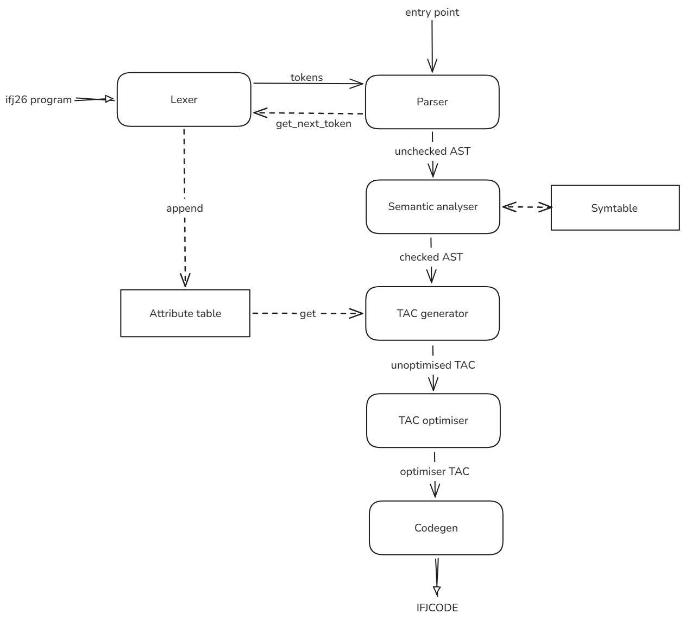

# IFJ26 Scala Compiler

A compiler for IFJ26, subset of Scala programming language, developed as VUT FIT Formal Languages and Compiler course
project

# Overview

Dwaine compiler is a complete compiler for IFJ26 language, Scala 3.8.1 subset, which converts `.ifj` source file firstly
to three-address
code (TAC), applies optimisations and compiles down to IFJCODE pseudo-assembly code, which can be interpreted.

# Team

| Name                 | Login     | Contribution                                   |
|----------------------|-----------|------------------------------------------------|
| Daniil Didenko       | xdidend00 | team-lead, parser, expression-parser, symtable |
| Oleksandr Fedorenko  | xfedoro00 | tac generation, tac optimisation               |
| Vladyslav Doroshenko | xdorosv00 | semantic analysis, type checking               |
| Maksym Sereda        | xseredm00 | lexical analysis, code generation              |

# Project architecture



# Project structure

```
Dwayne-Compiler-IFJ26/
├── src/                        # Source files
│   ├── main.c                  # Compiler entry point
│   ├── lexer.c                 # Lexical analyzer
│   ├── parser.c                # Syntax parser
│   ├── semantic_analyser.c     # Semantic analyser
│   ├── tac.c                   # TAC generation
│   ├── tac_optimiser.c         # TAC optimisation
│   ├── codegen.c               # Code generation
│   ├── symtable.c              # Symbol table management
│   ├── bst.c                   # Binary search tree (used inside symtable)    
│   ├── ast.c                   # AST node
│   ├── attribute_table.c       # Attribute table (used for storing literals and identifiers)
│   ├── stack.c                 # Generic stack
│   ├── utils.c                 # Utilitary functions
│   ├── error.c                 # Error handling
│   │
│   │   # Header files
│   ├── lexer.h
│   ├── token.h                 # Token structure definition 
│   ├── parser.h
│   ├── semantic_analyser.h
│   ├── tac.h
│   ├── tac_optimiser.h
│   ├── codegen.h
│   ├── symtable.h
│   ├── bst.h    
│   ├── ast.h
│   ├── attribute_table.h
│   ├── stack.h
│   ├── utils.h
│   ├── error.h                 # Error codes declaration
│   │
│   └── Makefile            # Build and formatting
├── ic26int-linux-x86_64    # Interpreter
├── docs/                   # Documentation
└── README.md               
```

# Requirements

* Operating system: Linux or Windows ith WSL
* Compiler: GCC with ISO-C11 support
* Make build tool
* Clang formatter

# How to build

### Clone repo

```bash
git clone https://github.com/d-danjok/Dwayne-IFJ26-Compiler.git
cd Dwayne-Compiler-IFJ26/src
```

### Build

```bash
make build
```

### Other options

`make fmt`- formats code with `clang-format`

# How to use

### Compile

```bash
./ifj26 < src_code.ifj26 > code.ifjcode
```

### Run

```bash
./ic26int-linux-x86_64 code.ifjcode
```

# Error codes

| Code | Error                              |
|------|------------------------------------|
| 0    | None                               |
| 1    | Lexical                            |
| 2    | Syntactical                        |
| 3    | Semantical: Use without definition |
| 4    | Semantical: Invalid definition     |
| 5    | Semantical: Wrong function args    |
| 6    | Semantical: Type incompability     |
| 7    | Semantical: Mutation of constant   |
| 10   | Semantical: Other                  |
| 99   | Internal error                     |

# Example of IFJ26 program

```scala
import ifj26.*

def fib(n : Int): Int =
  if n == 0 then
    return 0
  if n == 1 then
    return 1
    
  return fib(n-1) + fib(n-2)
  
@main def main(): Unit = 
  val i = readInt()
  print(fib(i))
```